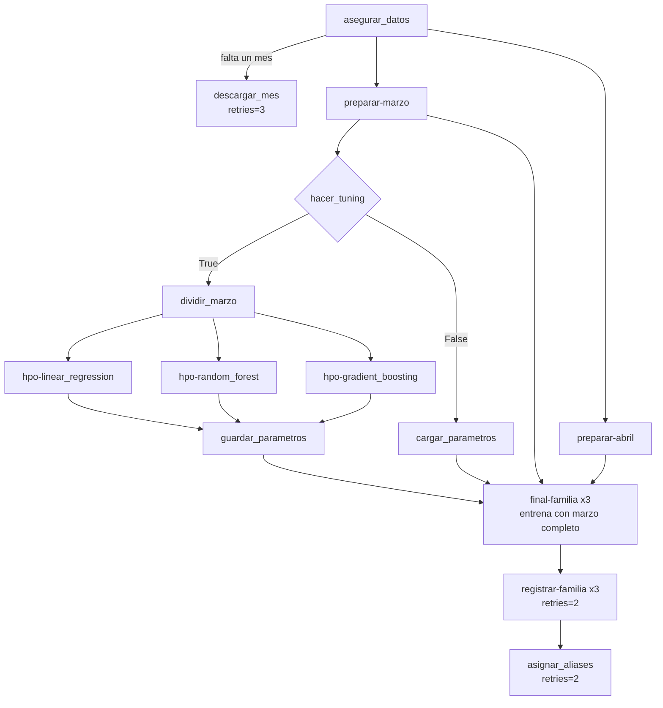
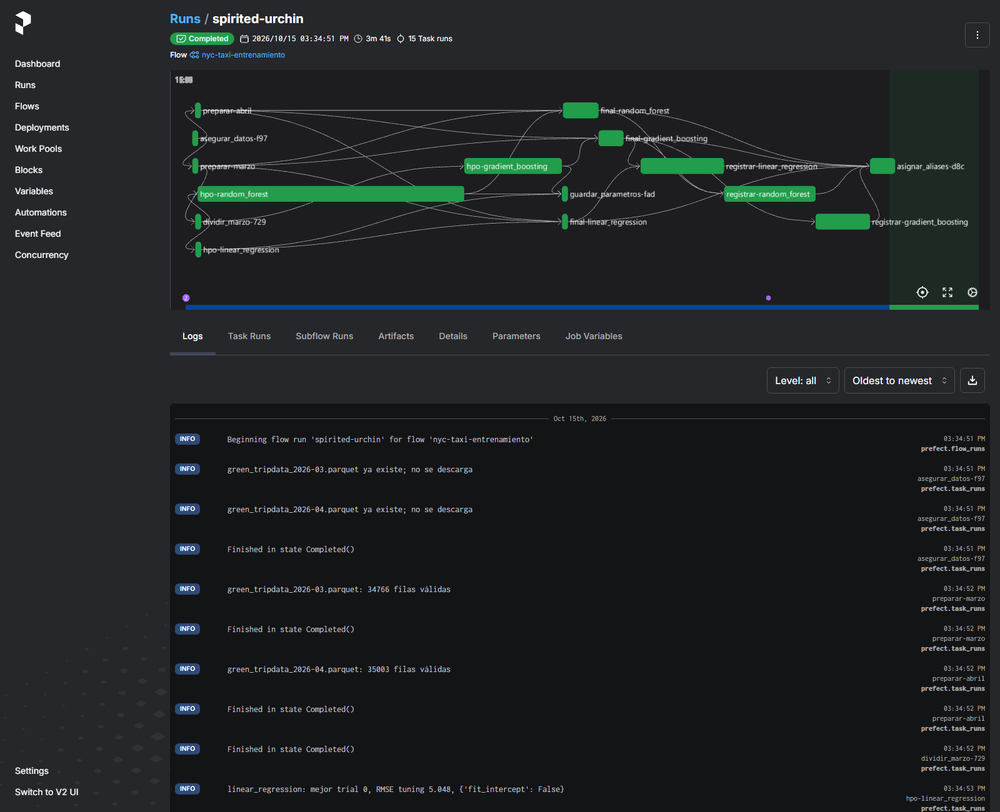
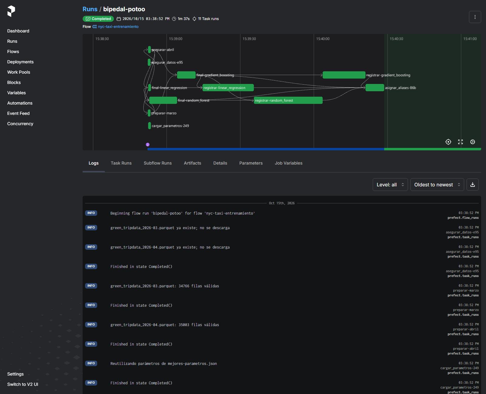
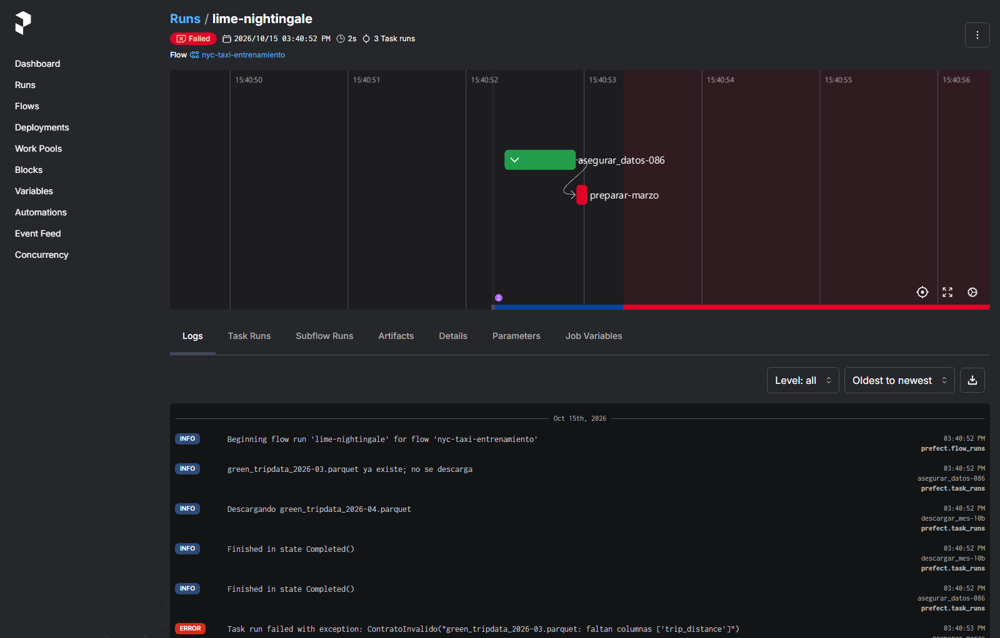

# Tarea 6: Orquestar el pipeline de entrenamiento con Prefect

## 1. Objetivo

Convertir el script de la Tarea 5 en un flow reproducible de Prefect. Se conservan las tres familias (`LinearRegression`, `RandomForestRegressor`, `GradientBoostingRegressor`), las cinco features, los mismos espacios de HPO con Optuna, el tracking en Databricks y los aliases dinámicos. Lo nuevo es la orquestación: cada paso es una task con entradas y salidas explícitas, con reintentos solo donde tienen sentido y con un modo que reutiliza los hiperparámetros guardados.

## 2. Archivos

| Archivo | Contenido |
|---|---|
| `pipeline_prefect.py` | Flow `nyc-taxi-entrenamiento` y sus tasks. |
| `mejores-parametros.json` | Mejores hiperparámetros por familia, escritos por la corrida con `hacer_tuning=True`. |
| `evidencias/` | Capturas de la UI local de Prefect. |

## 3. Diagrama del flow



Abril solo entra por la arista `preparar-abril → final-familia`. Ninguna task de HPO lo recibe.

## 4. Función de cada task

| Task | Qué hace | Reintentos |
|---|---|---|
| `asegurar_datos` | Revisa si `green_tripdata_2026-03.parquet` y `green_tripdata_2026-04.parquet` existen en `directorio_datos` y llama a `descargar_mes` solo para los faltantes. | No |
| `descargar_mes` | Descarga un mes desde el CDN de NYC TLC a un archivo `.part` y lo renombra al terminar, para no dejar un Parquet a medias. | 3 (5, 15 y 30 s) |
| `preparar_y_validar` (`preparar-marzo`, `preparar-abril`) | Valida el contrato del Parquet crudo (seis columnas requeridas y fechas tipo datetime), construye las cinco features y el target, filtra rangos y verifica que el resultado no quede vacío. Es la misma función para ambos meses. Lanza `ContratoInvalido` si algo no cumple. | No |
| `dividir_marzo` | Divide marzo 80/20 (`random_state=42`) en entrenamiento interno y validación de tuning. | No |
| `ajustar_familia` (`hpo-<familia>`) | Estudio de Optuna de una familia. Recibe solo las dos particiones de marzo y devuelve mejores parámetros, RMSE de tuning y número de trial. | No |
| `guardar_parametros` | Escribe `mejores-parametros.json`. | No |
| `cargar_parametros` | Lee `mejores-parametros.json` y verifica que estén las tres familias. | No |
| `entrenar_y_evaluar` (`final-<familia>`) | Reentrena la familia con marzo completo y calcula una vez el RMSE sobre abril. | No |
| `registrar_modelo` (`registrar-<familia>`) | Crea el run final en MLflow (Databricks), registra métricas, parámetros, tags y el modelo en Unity Catalog. | 2 (10 s) |
| `asignar_aliases` | Ordena por RMSE de abril y asigna `champion`, `challenger` y `candidate`; agrega tags de familia, RMSE y periodo a cada versión. | 2 (10 s) |

### Por qué los reintentos están solo ahí

`descargar_mes`, `registrar_modelo` y `asignar_aliases` hablan con servicios externos (CDN, Databricks), donde una falla de red o un timeout puede resolverse solo. Un schema inválido, en cambio, es determinista: volver a leer el mismo archivo da el mismo error. Por eso `preparar_y_validar` no tiene reintentos y el flow se detiene en el primer intento con un mensaje que nombra el archivo y las columnas faltantes.

## 5. Por qué abril queda fuera del HPO

Abril es el periodo de validación final. Si el estudio de Optuna lo viera, los hiperparámetros quedarían elegidos para minimizar el error en abril y el RMSE reportado dejaría de ser una estimación honesta del desempeño en un mes nuevo; sería un error de entrenamiento disfrazado de validación.

En el código esto se garantiza por construcción, no por disciplina:

- `ajustar_familia(familia, train, validacion)` y `crear_objetivo(...)` solo aceptan las dos particiones de marzo; no hay variables globales con datos.
- Cuando `hacer_tuning=True`, el flow pasa `marzo_train` y `marzo_tuning`, que salen de `dividir_marzo(marzo)`.
- `abril` solo se pasa a `entrenar_y_evaluar`, una vez por familia, después de fijar los parámetros.

## 6. MLflow y Registry

- Tracking: `databricks`. Registry: `databricks-uc`.
- Experimento: `/Shared/pcd-otono-2026-tarea-06-nyc-taxi`.
- Modelo registrado: `workspace.default.nyc_taxi_trip_duration_tarea_06`.

Cada ejecución crea exactamente tres runs (`linear-regression-final`, `random-forest-final`, `gradient-boosting-final`), uno por modelo final. Los trials de Optuna no se registran en MLflow; su resultado queda en los logs de Prefect y en `mejores-parametros.json`. Cada run guarda el tag `params_source` (`hpo` o `mejores-parametros.json`) para distinguir de dónde salieron los parámetros.

Los aliases se calculan en cada ejecución ordenando por `validation_rmse`; no están fijos por familia. Si en otra corrida Random Forest superara a Gradient Boosting, recibiría `champion` sin cambiar código.

## 7. Resultados

### Mejores hiperparámetros (`mejores-parametros.json`)

| Familia | Trials | Mejor trial | Hiperparámetros | RMSE tuning (min) |
|---|---:|---:|---|---:|
| Linear Regression | 2 | 0 | `fit_intercept=False` | 5.048 |
| Random Forest | 8 | 2 | `n_estimators=50`, `max_depth=16`, `min_samples_leaf=5` | 4.343 |
| Gradient Boosting | 8 | 3 | `n_estimators=200`, `learning_rate≈0.166`, `max_depth=4`, `min_samples_leaf=3` | 4.235 |

Son los mismos valores que en la Tarea 5, como se espera con las mismas semillas, samplers y partición.

### Ranking final (RMSE sobre abril)

| Alias | Familia | RMSE abril (min) | Entrenamiento (s) | Versión con `hacer_tuning=True` | Versión con `hacer_tuning=False` |
|---|---|---:|---:|---:|---:|
| `champion` | Gradient Boosting | 4.349 | ~7.5 | v3 | v6 |
| `challenger` | Random Forest | 4.492 | ~11 | v2 | v5 |
| `candidate` | Linear Regression | 5.108 | ~0.3 | v1 | v4 |

Los aliases apuntan a la última ejecución (v4 a v6). Ambas corridas producen el mismo RMSE, lo que confirma que reutilizar el JSON da los mismos modelos que el HPO.

- **`champion`, Gradient Boosting:** menor error, 0.143 min (~9 s por viaje) mejor que el bosque y además entrena más rápido que él.
- **`challenger`, Random Forest:** segundo lugar con poca distancia; es la alternativa natural si el campeón falla.
- **`candidate`, Linear Regression:** el más simple y rápido, pero con 0.76 min (~46 s) más de error que el campeón.

## 8. Ejecución

Desde la raíz del repositorio:

```bash
uv sync --locked

# Opcional, para ver los runs en la UI local (http://127.0.0.1:4200)
uv run prefect server start --host 127.0.0.1 --port 4200
# en otra terminal:
export PREFECT_API_URL=http://127.0.0.1:4200/api

# Con HPO: corre los tres estudios y reescribe mejores-parametros.json
uv run python tareas/tarea-06-pipeline-prefect/pipeline_prefect.py --hacer-tuning

# Sin HPO: reutiliza mejores-parametros.json
uv run python tareas/tarea-06-pipeline-prefect/pipeline_prefect.py
```

Requiere `.env` en la raíz con `DATABRICKS_HOST` y `DATABRICKS_TOKEN`. Los Parquet se descargan solos si faltan. Ni `.env`, ni `data/`, ni los modelos se versionan.

### Reproducir la falla controlada

```bash
uv run python -c "
import pandas as pd; from pathlib import Path
d = Path('data/nyc-taxi-sin-columna'); d.mkdir(exist_ok=True)
pd.read_parquet('data/nyc-taxi/green_tripdata_2026-03.parquet').drop(columns='trip_distance').to_parquet(d / 'green_tripdata_2026-03.parquet')
"
uv run python tareas/tarea-06-pipeline-prefect/pipeline_prefect.py --directorio-datos data/nyc-taxi-sin-columna
```

La carpeta tiene marzo sin `trip_distance` y no tiene abril. El flow descarga solo abril, luego `preparar-marzo` falla con `ContratoInvalido: green_tripdata_2026-03.parquet: faltan columnas ['trip_distance']` y el flow termina en `Failed` sin reintentar ni llegar a MLflow.

## 9. Evidencia

### Flow exitoso con `hacer_tuning=True`

Se ven las 15 task runs: `asegurar_datos`, `preparar-marzo`, `preparar-abril`, `dividir_marzo`, las tres `hpo-*`, `guardar_parametros`, las tres `final-*`, las tres `registrar-*` y `asignar_aliases`.



### Flow con `hacer_tuning=False`

No aparecen `dividir_marzo` ni las `hpo-*`; en su lugar `cargar_parametros` registra "Reutilizando parámetros de mejores-parametros.json". Son 11 task runs.



### Falla controlada por columna faltante

`asegurar_datos` termina bien (descargó abril) y `preparar-marzo` queda en rojo con el mensaje de `ContratoInvalido`. El flow termina en `Failed` en 2 s, sin reintentos.


